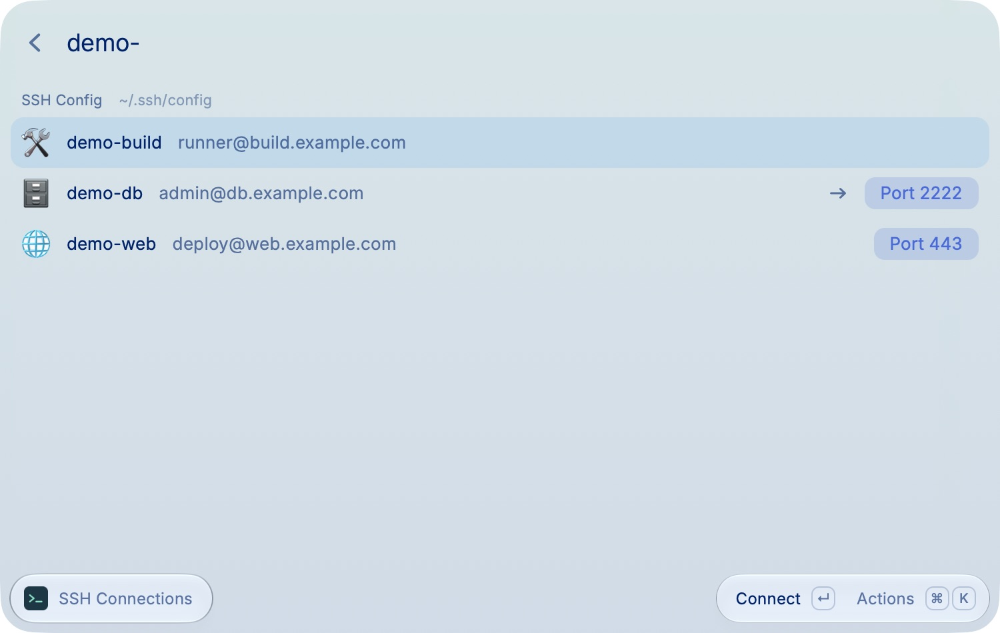
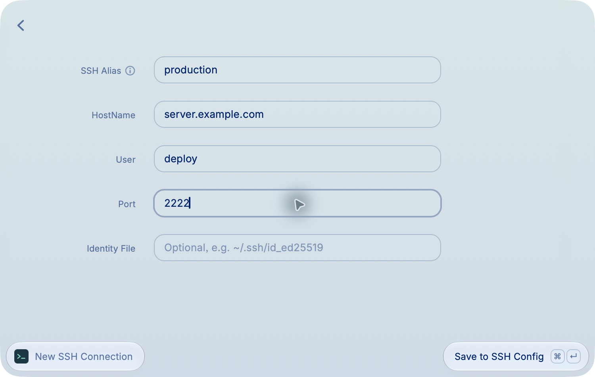

# SSH Connections

在 Raycast 中搜索和管理 SSH 连接，按回车使用你选择的终端登录。连接直接使用本机 OpenSSH 配置，也可以为常用主机设置 emoji。



截图使用虚构的示例主机和地址。

## 安装与启动

需要 macOS、Raycast、Node.js 和 pnpm。在本目录执行：

```sh
pnpm install --frozen-lockfile
pnpm dev
```

`pnpm dev` 会构建扩展、将它加入本机 Raycast，并持续监听源码变化；停止开发进程使用 `Ctrl+C`。在 Raycast 中搜索 **SSH Connections** 打开列表，也可以在 Raycast 设置中为命令绑定快捷键。

## 连接与管理

列表自动读取 `~/.ssh/config` 和 `Include` 文件中的具体主机别名。搜索别名、主机地址或用户名，选中连接后按 **Return** 启动 SSH。通配符和排除规则不会作为独立连接显示。

按 **⌘ N** 新建连接：填写 SSH Alias，以及可选的 HostName、User、Port 和 Identity File；留空的字段交给 SSH 的配置和默认值处理。保存后会写入 `~/.ssh/config`。



选中连接后按 **⌘ K** 打开操作菜单：

| 操作 | 用途 |
| --- | --- |
| Connect | 在默认终端连接所选主机 |
| Edit Connection（⌘ E） | 编辑别名、主机、用户名、端口和密钥路径 |
| Edit SSH Options | 编辑代理、转发和其他常用 SSH 选项 |
| Set Icon | 为该 Host 块设置一个 emoji |
| Copy SSH Command（⌘ ⇧ C） | 复制可在终端运行的 SSH 命令 |
| Delete Connection（⌘ ⇧ ⌫） | 确认后删除对应的 Host 块 |
| Refresh SSH Config（⌘ R） | 重新读取外部修改的配置 |
| Terminal Preferences | 打开扩展设置，选择默认终端 |

## 终端与认证

在扩展偏好设置的 **Default Terminal** 中选择 Terminal、iTerm 或 Ghostty，所选应用需已安装。首次使用时 macOS 可能要求允许 Raycast 控制终端；Ghostty 使用 AppleScript 窗口配置接口，已在 Ghostty 1.4.0 测试。

连接会调用本机 `/usr/bin/ssh`，认证、密钥口令和主机指纹提示由 SSH 和终端处理。扩展保存密钥路径，不保存密码或私钥内容。终端窗口打开不代表登录成功，请查看终端里的认证结果；Ghostty 会在命令结束后保留窗口以便查看错误。

## 列表、图标与 SSH 选项

列表显示可直接读取的地址和用户名；右侧的端口、密钥、代理、Agent 转发、端口转发和远程命令图标表示 **Host 块中的静态配置**，不是实时连接状态。部分 SSH Config Editor 图标会自动映射为 emoji；其颜色标签仍保存在配置注释中，但不显示在列表里。

**Set Icon** 的自定义 emoji 以 `#SSHManagerIcon` 注释保存在对应 Host 块；共享块的别名共用图标。清空 emoji 可恢复 SSH Config Editor 图标或默认图标。

**Edit SSH Options** 支持 `ForwardAgent`、`ServerAliveInterval`、`ProxyJump`、`ProxyCommand`、`RemoteCommand`、`RequestTTY`、`LocalForward`、`RemoteForward` 和 `DynamicForward`。清空字段会移除该块中相应的指令；其他指令和独立注释会保留，修改的指令行内注释可能被替换。

对包含显式主机匹配的条件规则，列表会显示 **Conditional route** 和可静态读取的候选地址。列表不会执行 `Match` 命令或检测当前路由；实际连接时，SSH 才会按完整配置计算路径。复杂规则及继承值可能不会完整显示，前面的全局或 `Match` 指令也可能优先生效。

## 配置编辑限制

为保留现有配置，包含多个不同 Host 模式、重复别名、重复受管字段或 `Include` 的复杂块需要在文本编辑器中手动修改。只有大小写不同的等价 Host 模式可以编辑字段；带显式主机 `Match` 条件的别名，以及多个等价拼写的 Host 块，重命名和删除仍需手动处理。悬空的配置文件符号链接不会被覆盖。

新增块放在全局指令之后、首个 `Host` 或 `Match` 之前，已有的前置全局配置或 `Include` 仍可能优先生效。外部修改文件后可重新打开命令，或使用 **Refresh SSH Config**。

旧版本保存在 Raycast LocalStorage 的连接会显示在 **Previous Raycast Connections**。用 **Copy to SSH Config** 复制，检查无误后再删除旧条目；备注和收藏状态不会写入 SSH 配置。

## 开发检查

```sh
pnpm test
pnpm lint
pnpm exec tsc --noEmit
pnpm build
```
